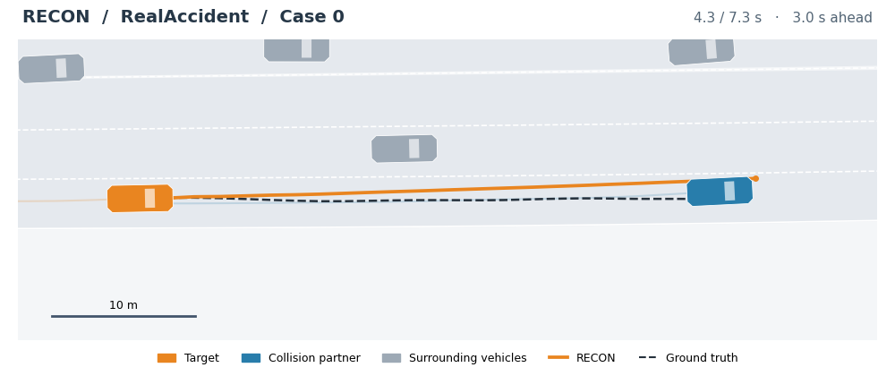
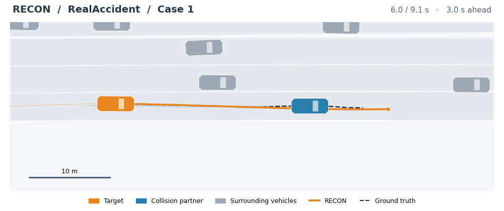
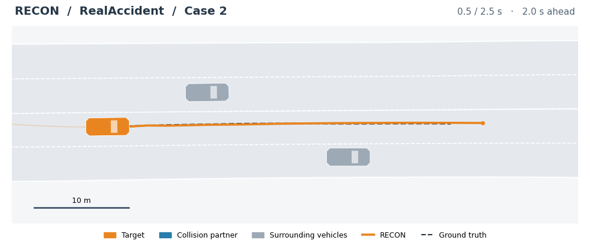
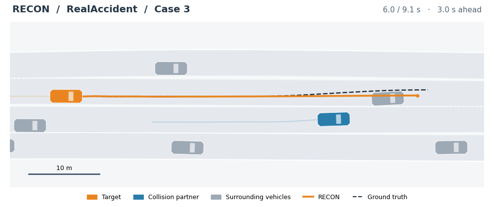
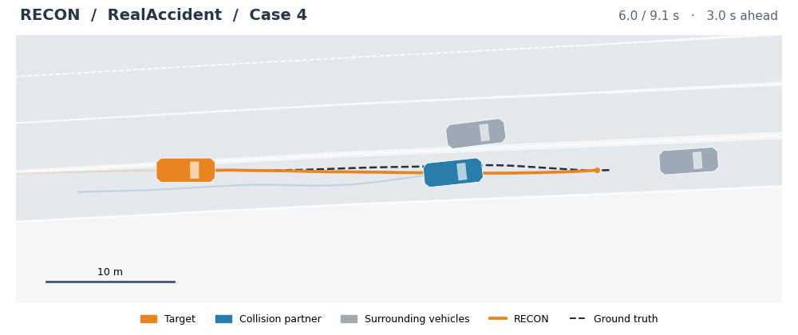
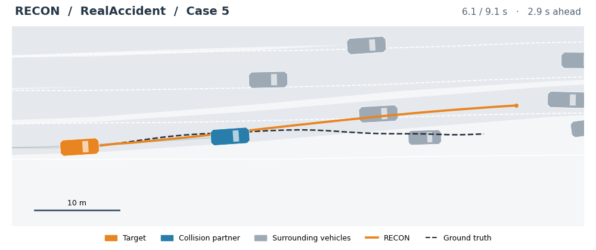
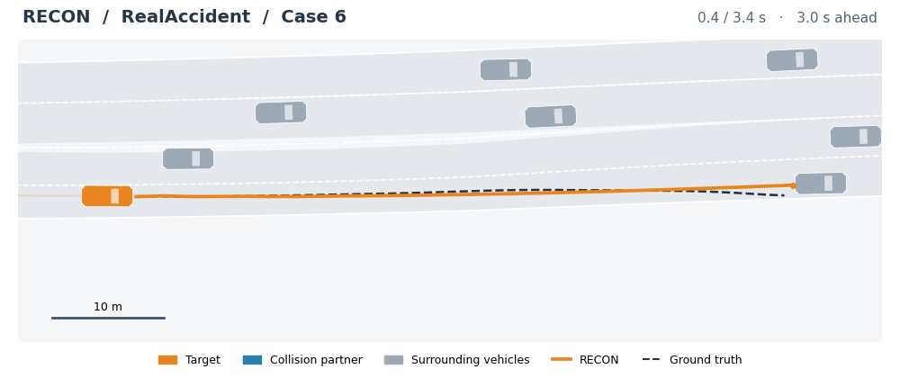
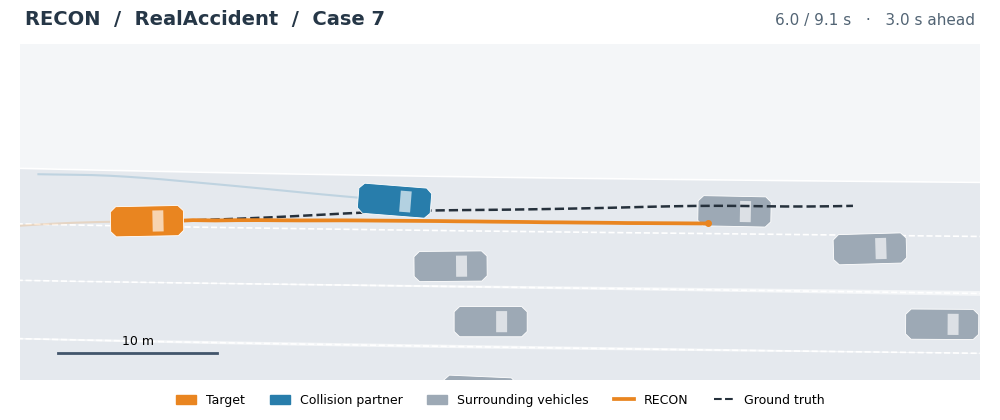
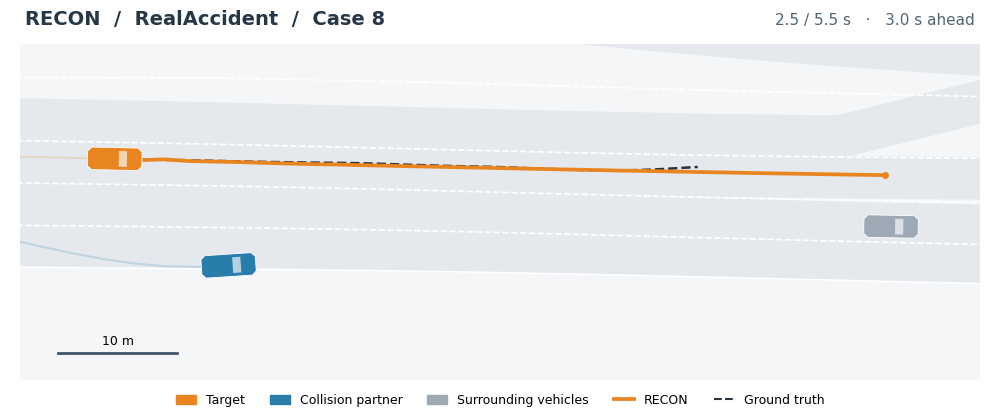

# RECON

Code for **RECON: Normal Driving References for Confidence Learning in Multimodal Accident Trajectory Prediction**, built on [UniTraj](https://github.com/vita-epfl/UniTraj).

This source release contains RECON, ten comparison models, three component ablations, training configurations, data adapters, conversion tools, the unified evaluator, and rendered prediction demonstrations. It contains **no datasets, checkpoints, normal prototype files, clustered endpoints, token dictionaries, or raw prediction records**. Users must prepare their own data and model assets.

## RealAccident demonstrations

<table>
  <tr>
    <td align="center" width="33%"><a href="assets/animations/case_0.gif"></a><br><b>Case 0</b></td>
    <td align="center" width="33%"><a href="assets/animations/case_1.gif"></a><br><b>Case 1</b></td>
    <td align="center" width="33%"><a href="assets/animations/case_2.gif"></a><br><b>Case 2</b></td>
  </tr>
  <tr>
    <td align="center" width="33%"><a href="assets/animations/case_3.gif"></a><br><b>Case 3</b></td>
    <td align="center" width="33%"><a href="assets/animations/case_4.gif"></a><br><b>Case 4</b></td>
    <td align="center" width="33%"><a href="assets/animations/case_5.gif"></a><br><b>Case 5</b></td>
  </tr>
  <tr>
    <td align="center" width="33%"><a href="assets/animations/case_6.gif"></a><br><b>Case 6</b></td>
    <td align="center" width="33%"><a href="assets/animations/case_7.gif"></a><br><b>Case 7</b></td>
    <td align="center" width="33%"><a href="assets/animations/case_8.gif"></a><br><b>Case 8</b></td>
  </tr>
</table>

Scenes play at **10 Hz**, with RECON forecasts updated every **1 second**.
Orange marks the target and its highest confidence prediction, blue the collision
partner, gray surrounding vehicles, and the dashed curve the labeled future.
Displayed predictions shorten with time and stop at the available future labels.

[Playback details and individual animations](docs/ANIMATIONS.md).

## Models and configurations

All configurations below are complete method YAMLs in `unitraj/configs/method/`.

| Paper name | Method YAML | Implementation |
|---|---|---|
| RECON | `RECON.yaml` | `models/recon/recon.py::RECON` |
| NoAuxGeo | `RECON_NoAuxGeo.yaml` | RECON without auxiliary trajectory supervision |
| NoScoreBranch | `RECON_NoScoreBranch.yaml` | RECON without the added confidence scoring branch |
| NoProto | `RECON_NoProto.yaml` | RECON without the normal prototype pathway |
| AutoBots | `autobot.yaml` | `models/autobot/` |
| MTR | `MTR.yaml` | `models/mtr/` |
| Wayformer | `wayformer.yaml` | `models/wayformer/` |
| Forecast-MAE | `MAE.yaml`, `forecast.yaml` | `models/fmae/` (pretraining and forecasting) |
| GameFormer | `GAMEFORMER.yaml` | `models/gameformer/` |
| SeNeVA | `SENEVA.yaml` | `models/seneva/` |
| EMP | `EMP.yaml` | `models/emp/` |
| BeTopNet | `BeTopNet.yaml` | `models/betopnet/` |
| SMART | `SMART.yaml` | `models/smart/` |
| TrajFlow | `TrajFlow.yaml` | `models/trajflow/` |

The Wayformer name remains on the original baseline and shared encoder/decoder code. RECON has its own implementation and class. Historical RECON-LP and exploratory C/P/F configurations are outside this initial release.

## Environment

Use Python 3.9 and install [ScenarioNet and MetaDrive](https://scenarionet.readthedocs.io/en/latest/install.html) first. The development environment used PyTorch 2.4.1 with CUDA 12.1, Lightning 2.6.0, Hydra 1.3.2, ScenarioNet 0.0.1 and MetaDrive 0.4.3. These identify the existing environment; a fresh installation of all optional baseline dependencies has not been verified.

From this repository root:

```bash
pip install -r requirements.txt
pip install -e . --no-build-isolation
```

Additional baselines use packages listed in `requirements-baselines.txt`. Install the required subset with builds compatible with your PyTorch and CUDA versions. MTR, BeTopNet and TrajFlow require the MTR CUDA operators. With CUDA toolkit and a compatible compiler installed:

```bash
RECON_BUILD_CUDA=1 pip install -e . --no-build-isolation
```

## Data and model assets

See [data preparation](docs/DATA.md) for the expected directory layout and converter entry points. No data download runs automatically. Set `RECON_DATA_ROOT` to your prepared data root or edit the paths in the YAML files.

| Model | Assets to prepare yourself |
|---|---|
| RECON and NoAuxGeo | A frozen normal driving prototype dictionary generated from your trained Wayformer and normal training data |
| NoProto and NoScoreBranch | No normal prototype dictionary is used by the active network |
| MTR and BeTopNet | Endpoint clusters, generated from normal training data by `tools/gen_intention_points.py`; `train.py` invokes preparation if missing |
| TrajFlow | Endpoint clusters matching its `MODEL_DMT.DMT.INTENTION_POINTS_FILE` configuration; prepare these before training |
| SMART | Agent tokens from `tools/gen_agent_tokens.py` and the map token dictionary required by the SMART implementation; neither is distributed here |
| Forecast-MAE | Your own MAE pretraining checkpoint if using the pretrained forecasting recipe |

To build a RECON prototype dictionary after training Wayformer, run from `unitraj/`:

```bash
python models/wayformer/extract_normal_prototypes.py \
  --ckpt /path/to/your_wayformer.ckpt \
  --split train --clusters 64 --output-dir artifacts/prototypes
```

For highD, also provide `--data-root` and `--data-path` for your normal highD training split. A prototype dictionary is a required input to the full model, not a randomly generated replacement. The dictionary builder uses Wayformer weights; RECON itself starts from random initialization unless you explicitly set `pretrained_path` or resume a checkpoint.

## Training

Run all training commands from `unitraj/`, using the same `train.py` entry point and method YAMLs as the research project:

```bash
cd unitraj
python train.py method=wayformer exp_name=wayformer_waymo
python train.py method=RECON exp_name=recon_waymo
python train.py method=RECON_NoAuxGeo exp_name=recon_no_aux_geo_waymo
python train.py method=RECON_NoScoreBranch exp_name=recon_no_score_branch_waymo
python train.py method=RECON_NoProto exp_name=recon_no_proto_waymo
```

`config.yaml` controls data paths, target selection, scene sampling, GPUs, workers, and output names. Each method YAML controls architecture, losses, optimization, epochs and scene batch size **per GPU**. The shared object cap is 64 prediction targets per batch, not 64 scenes. Choose devices and workers for your own server.

The current shared example retains `limit_train_batches: 0.2` and `limit_val_batches: 0.5`. Per-model epoch counts, schedules and batch sizes remain in the supplied YAMLs; they are not forced to identical values. Set these explicitly for your experiment. This example is not a claim that every historical paper run used the same budget.

Checkpoints and training CSVs are generated under `unitraj_ckpt/<exp_name>/`. A repeated experiment name with `resume_policy=auto` resumes its latest saved epoch. Use a new name for a new run. Validation chooses the best checkpoint; `last.ckpt` also preserves training state.

## Unified evaluation

Edit `configs/eval.yaml` to select the method, your checkpoint, device and available datasets, then run:

```bash
python benchmark_eval.py method=RECON ckpt_path=/path/to/your_recon.ckpt
```

The evaluator uses the same metric implementation as the research project. Its default dataset list covers Waymo, highD, DeepAccident normal/collision subsets and RealAccident collision/single vehicle subsets. Remove unavailable dataset entries before running; RealAccident is not distributed. Results are generated in `final_metrics/` and are ignored by Git. See [the evaluation protocol](docs/PROTOCOL.md).

## Source layout

```text
datasets/                 conversion code only
docs/                     data requirements, protocol, license
assets/animations/        rendered RealAccident GIFs and previews
unitraj/
  train.py                training entry
  benchmark_eval.py       unified evaluation entry
  build_eval_summary.py   CSV aggregation
  configs/                shared config, evaluation config, method YAMLs
  models/                 RECON and baseline implementations
  datasets/               shared processing and per-model input adapters
  tools/                  checkpoint and model-asset preparation helpers
  utils/                  common utilities
```

This project retains the upstream UniTraj license and existing source attributions. See [LICENSE](LICENSE), [the full license text](docs/LICENSE.AGPL) and [source acknowledgments](THIRD_PARTY_NOTICES.md). No repository URL or arXiv identifier is claimed until those releases exist.
